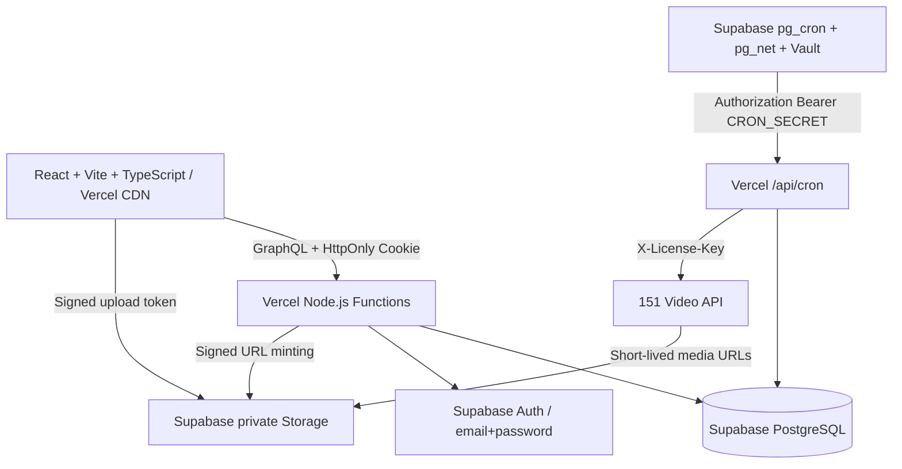

# AutoJuben Cloud v0.3.0 — Vercel + Supabase Architecture

This document describes the deployable 0.3.0 architecture; the 0.2.x Docker architecture is retired.

## Service behavior and authorization

- No Windows process management, Docker Socket, private upload volume or `setInterval` background process exists on Vercel.
- All users authenticate against Supabase Auth. The Vercel backend issues its own random, hashed PostgreSQL-backed session; a cookie is HttpOnly and Secure for HTTPS.
- Every project, video job, uploaded asset and launcher management operation authorizes the tenant and role in TypeScript before SQL mutation.
- The application enables RLS on the public SQL tables without granting `anon` or `authenticated` table policies; its server-only Postgres connection is privileged. It never exposes `DATABASE_URL` or `SUPABASE_SECRET_KEY` to the browser.
- Upload flows create an expiring signed URL for one object, directly upload the file from browser to Storage, then verify size, content type and file signature before marking it ready.
- Background queue work is claimed under `FOR UPDATE SKIP LOCKED`, uses leases and an idempotency key, and retains ambiguous upstream POST operations as `submission_unknown` instead of retrying a possibly billable submission.
- Supabase Cron triggers once a minute. This bounds the granularity of progress updates, even when the React UI polls more frequently.

## Task state machine

`queued → submitting → pending/polling → success | failed`

When submitting is interrupted or the remote response is ambiguous, the status is `submission_unknown`; a tenant administrator must reconcile using the upstream task ID or confirm non-acceptance.

## Deployment and operational boundaries

- Vercel serves frontend static assets and Node.js Function invocations. Use Vercel Deployments and Logs for application releases and runtime logs.
- Supabase manages database, identity and private media Storage. Database backup service does not automatically include media objects; verify both backup streams.
- This project has an application-level, tenant-scoped Storage backup feature with a hard limit of 60 assets and 5000 jobs. It does not replace Supabase PITR or off-site backups.
- `VIDEO_API_BASE_URL` from the supplied integration document is plain HTTP and will transmit `X-License-Key` insecurely. Seek an HTTPS endpoint before production use.
- The business backend which the supplied EXE downloads is not included in the user-provided ZIP, so its script generation logic is not reproduced.
